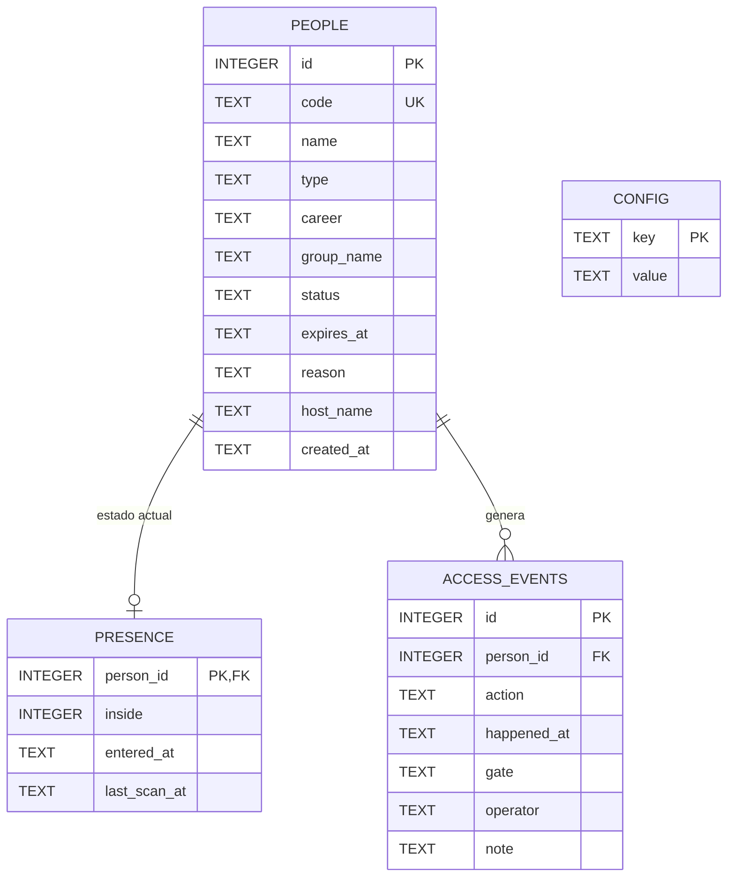
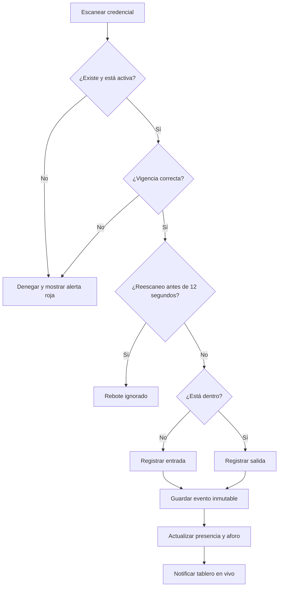
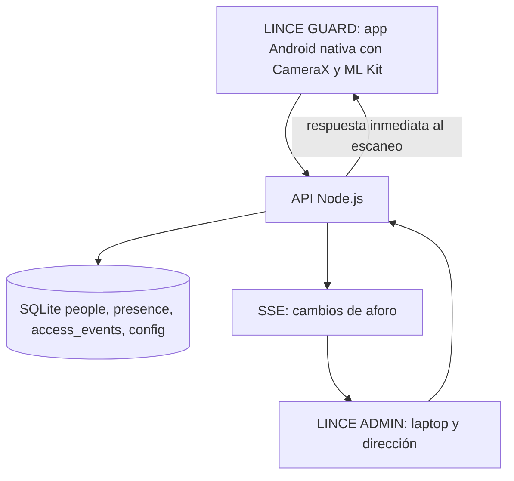

# Modelo relacional — V0.1

## Flujograma de validación

**Seguridad:** Los movimientos se conservan en `access_events`, protegido con disparadores contra UPDATE/DELETE. `presence` puede cambiar porque representa el estado actual, no un historial.

## Arquitectura V0.3 (mismo esquema SQLite)

Los clientes tienen interfaces diferentes pero utilizan los mismos endpoints. La sesión del guardia solo autoriza escaneo y visitantes; la del director no puede registrar accesos. El acceso por Wi-Fi de esta demo es HTTP y **no debe utilizarse fuera de red de pruebas privada**.

**V0.3:** la app Android consulta `/api/scan` y `/api/stats` usando su sesión; la web LINCE ADMIN escucha SSE. La app nativa no usa SSE por ahora.
